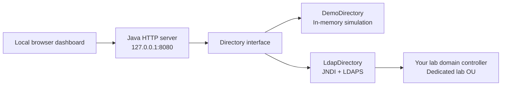

# Active Directory Lab — Java

A Java 21 directory-management dashboard for practicing help desk and junior administrator tasks: create users, security groups and organizational units; reset passwords; unlock accounts; and assign access through group membership.

**Run the demo on macOS, Windows or Linux with only a JDK.** Switch to LDAPS mode to perform the same operations against your own isolated Active Directory lab.


> Demo mode is an in-memory simulation, not an Active Directory server. The LDAPS adapter is implemented, but has not been tested against a live domain controller in this project's initial verification. Automated checks exercise demo behavior, HTTP routes, validation, and LDAP encoding and configuration guards.

## Features

| Task | Demo mode | Real AD mode |
| --- | --- | --- |
| List users, groups and OUs | Fictional sample directory | Read from configured lab OU |
| Create users | Salted PBKDF2 password hashes | Create disabled user, set password, require change, then enable |
| Create groups | Security-group simulation | Global security groups |
| Create OUs | Local demo containers | Direct children of the lab root OU |
| Reset passwords | Replace stored hash; require change | Write `unicodePwd`, then `pwdLastSet=0` |
| Unlock accounts | Clear simulated lock | Set `lockoutTime=0` |
| Add/remove direct membership | Update local membership | Modify the group's `member` attribute |
| Simulate account lock | Available for exercises | Disabled |
| Review activity | Last 50 successful session actions | Same app history; authoritative audit is in AD |

Permissions in this app are **group membership assignments**. Windows file/share ACLs, OU delegation, nested membership and primary-group membership are configured outside the app. The dashboard does not edit arbitrary ACLs or implement Windows authentication.

## Run in five minutes

Install a **JDK 21 or newer**. No Maven, database, npm or third-party Java libraries are required.

**macOS / Linux**

```sh
git clone https://github.com/kade258/active-directory-lab-java.git
cd active-directory-lab-java
sh tools/build.sh
java -jar .build/active-directory-lab.jar
```

**Windows PowerShell**

```powershell
git clone https://github.com/kade258/active-directory-lab-java.git
Set-Location active-directory-lab-java
.\tools\Build.ps1
java -jar .build/active-directory-lab.jar
```

Open **[http://127.0.0.1:8080](http://127.0.0.1:8080)**. Stop with **Ctrl+C**. Demo data and activity reset when Java restarts. Seeded users have random initial passwords; use **Manage → Reset password** to set one for an exercise. There is no user sign-in endpoint.

If a downloaded PowerShell script is blocked, inspect it, then use `Unblock-File .\tools\Build.ps1`. Your organization's execution policy may require an approved way to run scripts.

## Try the project

1. Open **Organizational units** and create `Helpdesk`.
2. Create `GG_Helpdesk` in **Groups & permissions**.
3. Create `sam.rivera` in the Helpdesk OU with a unique initial password.
4. Add Sam to `GG_Helpdesk`, verify membership, then remove it.
5. Open **Manage** beside `taylor.reed`, who begins locked in demo mode.
6. Reset Taylor's password and unlock the account. Resetting alone preserves the lock.
7. Review **Activity**. No passwords are included in the history.

See [guided exercises](docs/exercises.md) and the [validation checklist](docs/validation.md).

## Connect to your own Active Directory lab

Follow [Windows setup](docs/setup.md), then [Java LDAPS setup](docs/ldap.md). The Java machine must resolve and reach your domain controller. The adapter uses a delegated operator account and only manages descendants of the configured root OU.

```sh
java -jar .build/active-directory-lab.jar --ldap config/ldap.properties
```

Enter the bind password at the masked terminal prompt. It is not stored in the properties file or passed on the command line. AD mode requires a trusted LDAPS certificate, a dedicated lab OU and delegated rights. It does not fall back to plaintext LDAP or demo data on connection failure.

## Tests

```sh
# macOS / Linux
sh tools/test.sh
```

```powershell
# Windows
.\tools\Build.ps1 -Test
```

The dependency-free suite checks password replacement, lock/unlock behavior, case-insensitive account names, membership, duplicate/invalid input, escaped LDAP names, quoted UTF-16LE passwords, protected HTTP writes, request limits, bundled assets and password exclusion from responses. GitHub Actions runs it on Linux and Windows and parses the optional Windows infrastructure scripts.

Live AD behavior, certificates, delegation, Windows sign-in and VM provisioning require the separate [VM validation checklist](docs/validation.md).

## Design



| Path | Purpose |
| --- | --- |
| `src/main/java/lab/` | HTTP server, model, demo store and AD adapter |
| `src/main/resources/web/` | Dashboard HTML, CSS and JavaScript |
| `src/test/java/lab/LabTests.java` | Behavioral tests |
| `tools/` | Build and test commands |
| `config/ldap.example.properties` | Non-secret AD connection template |
| `scripts/`, `config/lab.psd1`, `data/users.csv` | Optional Windows guest setup and initial AD objects |
| `docs/` | Setup, exercises, troubleshooting and validation |

This is a single-operator local learning tool. It binds only to IPv4 loopback, checks its Host header, rejects cross-origin writes and requires a random per-process request token. It has no multi-user authentication or durable audit store. Other processes with access to your local account can interact with it. Keep it local; do not expose it through a public proxy or network listener.

## Portfolio wording

After completing the demo:

> Built a Java directory-management lab with user, group and OU management, password resets, account unlocking, group membership controls, and automated behavioral checks.

After validating against a real Windows domain, describe the real AD operations you performed. Keep evidence aligned with the mode you used; see [validation](docs/validation.md).

## References

- [JDK HTTP server API — Oracle](https://docs.oracle.com/en/java/javase/21/docs/api/jdk.httpserver/module-summary.html)
- [AD password changes over LDAP — Microsoft](https://learn.microsoft.com/en-us/troubleshoot/windows-server/active-directory/change-windows-active-directory-user-password)
- [Enable LDAPS — Microsoft](https://learn.microsoft.com/en-us/troubleshoot/windows-server/active-directory/enable-ldap-over-ssl-3rd-certification-authority)
- [Install Active Directory Domain Services — Microsoft](https://learn.microsoft.com/en-us/windows-server/identity/ad-ds/deploy/install-active-directory-domain-services--level-100-)
- [Domain join prerequisites — Microsoft](https://learn.microsoft.com/en-us/windows-server/identity/ad-ds/manage/join-computer-to-domain)

[MIT license](LICENSE). Windows and third-party software have separate licensing terms.
